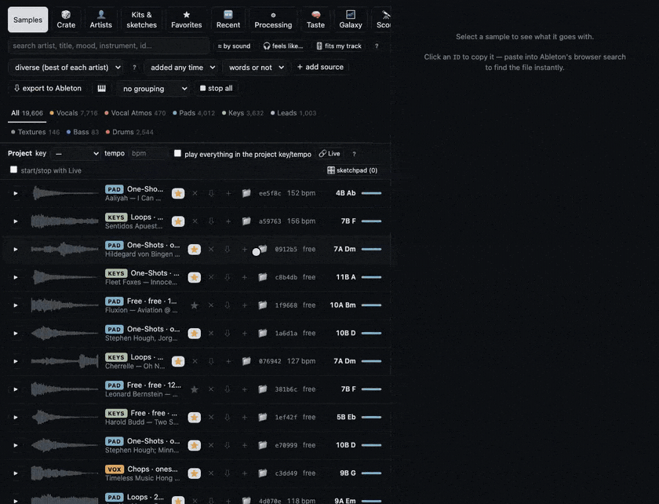
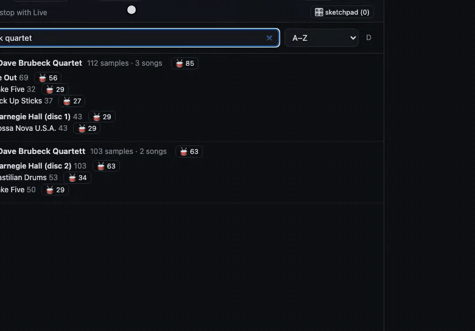
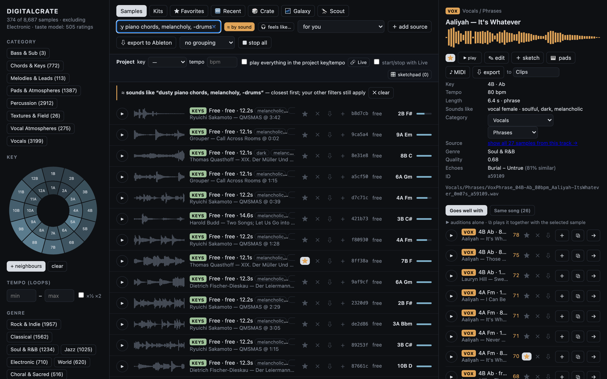
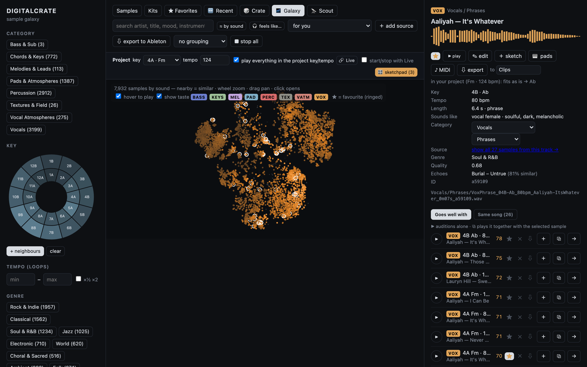
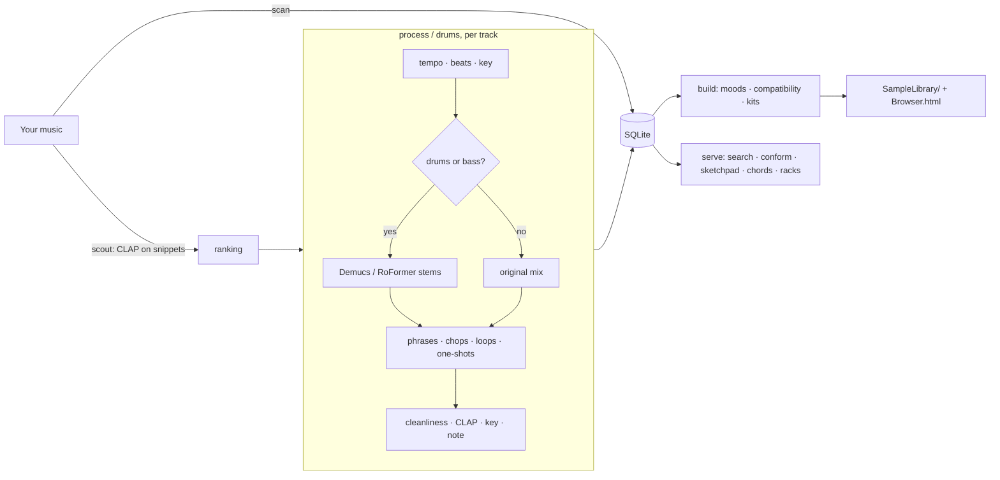

# DigitalCrate


[](https://github.com/jaredhuling/DigitalCrate/actions/workflows/tests.yml)

**Turn your music/record collection into a playable sample library.** DigitalCrate listens to the music you own, excerpts
the *clean* moments (exposed vocals, pads, chords, textures, drum hits), tags each with key, tempo, instrument and
mood, and gives you a browser-based studio to find, combine and reshape them before they go into a DAW like Ableton Live.



- **Mine** vocals, choirs, pads, chords, melodies, textures and drums from your own music, keeping only clean samples.
- **Find** sounds by category, artist, album, key, mood, or by *describing* them ("dusty piano chords, melancholy").
- **Combine** them in a sketchpad that keeps everything in key and on the grid, with chord progressions suggested
  for any sample and Drum Racks built from any song with percussive elements.
- **Export** to Ableton: organized folders, aligned stems, MIDI, and ready-made Drum Racks.
- **Learn your taste** from stars, skips and listening, and rank what you haven't heard yet.
- **Open it like any Mac app:** a one-line install, a first-run setup that asks where your music is, and no command
  line needed after that (though it's all there).

The small **?** buttons next to the less obvious features explain them.

## Quick start

For a Mac with Apple Silicon (M1 or later; other platforms aren't supported, see [Limitations](#limitations)).
Paste this into Terminal:

```bash
curl -fsSL https://raw.githubusercontent.com/jaredhuling/DigitalCrate/main/install.sh | bash
```

It installs what DigitalCrate needs (Homebrew if you don't have it, ffmpeg, rubberband, Python packages) and puts
**DigitalCrate** in your Applications folder. Open it like any app: the first time, it asks where your music is and
mines a first batch of samples (10 minutes to an hour, your choice), then opens your library. Run the same command
again to update. The app runs a small local server; ⏻ in the page turns it off, and opening the app turns it back on.

### By hand, and the command line

```bash
git clone https://github.com/jaredhuling/DigitalCrate.git digitalcrate && cd digitalcrate
uv venv --python 3.11 .venv
uv pip install --python .venv/bin/python --no-deps -r requirements.lock   # exact tested set (see note)
uv pip install --python .venv/bin/python --no-deps -e .
cp digitalcrate.example.toml digitalcrate.toml                             # where your music is, where the library goes

source .venv/bin/activate
digitalcrate app               # optional: DigitalCrate.app in ~/Applications (it does the steps below for you)
digitalcrate scan              # catalog your music (tags only, fast, incremental)
digitalcrate scout             # rank tracks by how sample-worthy they sound
digitalcrate process --top 200 # mine the 200 most promising tracks
digitalcrate drums --top 100   # drum hits and loops from tracks with live drummers
digitalcrate build             # tags, compatibility, kits, folder views, the browser page
digitalcrate serve             # → http://localhost:8765
```

- `requirements.lock` is installed with `--no-deps` on purpose: basic-pitch declares `resampy<0.4.3`, which breaks on
  current setuptools, so a normal resolver can't install the set that works.
- The first run downloads the models (Demucs, RoFormer, CLAP; a few GB). Processing is resumable; on an M4 a track
  takes 10 s to 2 min depending on stem separation. Wrap long runs in `caffeinate -i`.
- Pick tracks yourself with `process --artist "Marvin Gaye" "Aaliyah"`, `--match`, `--genre` or `--all`;
  `process --drum-only` mines songs that so far only gave up their drums.

## The studio

### Browse

Category **tabs** across the top (with live counts), the **🎲 Crate** right next to Samples, an **Artists** view
(artist → album → song, searchable, A–Z), and one-click filters for *this track · this album · everything by this
artist* in the sample panel. The panel on the right resizes by dragging its edge.

**★** keeps a sample (and links it into `Favorites/`), **✕** says *not for me* (it disappears from every list and
teaches the taste model). **🗑 delete** in the sample panel removes a sample for good, and *Same song* can delete
everything cut from a song at once (your favorites and edits are kept). Deleted files go to a trash folder: **undo**
brings them back, and `digitalcrate trash --empty` frees the space.

The **Goes well with** feature lists partners for the selected sample, scored on key (the Camelot wheel *and* the notes they
actually use), tempo, arrangement role and sound. You get the best overall plus the best few of every other
category; chips show one category at a time. **⧉** plays a pair together, **💾** saves it as a sketch.

### Sketchpad


Layer up to 8 samples, in the project key and tempo. Open a **kit** in it, or add samples with **＋**. **▾ hide**
tucks it away while it keeps playing: a small bar at the bottom says so, with **■ stop** and **▴ show**. Samples you
play are heard over the sketch (the now-playing bar says *with the sketch*), and Space stops the sample, then the
sketch. Click a saved sketch's name to open it without playing.

**Drum lane:** drum one-shots you add (＋, a kit, or **🎛 to the sketchpad** on a song's drum rack) become pads in one
drum lane, a step sequencer: 16 steps a bar, 1 or 2 bars, click a step for on → soft → off (scroll over it for its
exact velocity, ⌥-click for a flam), swing, humanize, choke groups (closed hat cuts off open hat), per-pad mute, and
a ✨ starter pattern from the pad types (kick, snare, hats…). **🔎 complete the kit** lists the kinds the kit is
missing (snare, clap, hats, cymbals, shaker, tom, percussion), three hits at a time that sound like they were recorded
with the pads you have: **↻ more** pages through 30 per kind, ✕ drops one for the next, **≈** steers a kind toward
one hit's sound, and a tick shows alternatives for the kinds you already have; **🥁 build a kit around this** on any drum hit starts one. ("Goes well with" finds more of the same
drum; this compares the recording's character, with what makes a kick a kick taken out: on your library's own songs
it picks a song's other drums out of all of that kind with AUC 0.83.) Pads start on the hit: most drum hits in a library open with
20–40 ms before the impact, so each pad's start is moved to it when it loads. Click a pad's name to edit it in place:
drag its start and end on the waveform, tune it (pitch and length together, like a sampler), shorten its decay, or
**↗ full editor** for punch, drive and low cut (save as new and the pad switches to your edit). Each pad has its own volume fader (every pad starts equally loud at 0 dB), and step edits, volumes and pad edits are heard at once while it plays. The sketchpad has its own tempo control (− / +, type it, or tap): a drums-only sketch changes tempo live; sample lanes are re-stretched. It's one lane, so mute, solo, its fader, bounce, stems
and the Live set treat it like any other.
**⇩ MIDI + rack** writes a Drum Rack of the pads (as edited, with their choke groups) and a MIDI clip of the pattern
(velocities, swing, flams): drop the rack on a track in Live, then the clip. **🥁 slice into pads** on a drum loop
cuts it at its hits into pads, each on the step where it fell, so the loop plays back as before and can be re-sequenced.

**Arrangement:** type sections into the sketchpad (`AABA`) and how many bars each lasts, then tick the letters on each
lane for the sections it plays in (all by default). Playback, bounce (*song* length), stems and the Live set follow it.

**Kits** are dealt for you: each starts from a vocal the taste model rates highly and adds a pad, chords or a melody,
a texture, a vocal chop and a bass from other songs that fit it in key and sound. ★ and ✕ change what they pick,
and **↻ new kits** deals a fresh set.

- **Visual timing:** amber lines are the project's bars and beats as each lane plays; white ticks are the clip's
  own attacks; ▼ marks the attack placed on the beat.
- **Pads vs rhythm:** each lane is checked for a steady pulse (Essentia's beat tracker). Pads and textures play from
  their start; rhythmic clips can **⟷ match tempo** so every attack stays on the grid, and **↺ re-align** fits a
  selection to the grid. ⌥-drag slides a lane by hand.
- **Per lane:** trim to any part of the clip, on/off, solo, fades, repeat every N bars, keep its own key, and a fader
  that's relative (every lane starts equally loud at 0 dB). Loops lock to the bar; other clips repeat on their own
  length so nothing leaves a gap.
- **Undo and saving:** **↶ ↷** (⌘Z / ⌘⇧Z) step back and forward through every change, a cleared or replaced sketch
  included; **save •** turns amber when the sketch has changes you haven't saved (⌘S saves); and your sketch is kept
  in the browser, so a refresh or a crash doesn't lose it.
- **Out:** save the sketch, bounce it to a new sample, **⇩ stems** (one WAV per lane, all the same length from
  bar 1), or **⇩ Live set**: an Ableton set with one audio track per lane and a clip wherever that lane plays, at the
  sketch's tempo, with muted lanes kept as muted tracks. It's built from your installed Live's own empty template.

### Chords for any sample


**🎼 chords** suggests progressions that suit a sample and plays them on a synth pad, with the chord lighting up on
a keyboard. Each chord is scored on how much of what the sample plays falls on its notes (and penalized for clashing a
semitone away); whole progressions are then chosen for good functional movement and smooth voice leading, in a
flavor that follows the sample's mood (soulful → 7ths and 9ths, dark → minor 9ths, ethereal → sus and add9).
Voicings sit in a different register from the sample so they don't mask it.

If the sample has **chords of its own**, suggestions change where it does: *follows* enriches its chords in another
register, *reharmonized* swaps in chords that still contain what it plays.

**Bass** adds a bassline built from the chords: held roots, root and fifth, an 8th-note pulse, syncopated R&B, or a
walking line with chromatic approach notes (the default follows the sample: walking for jazz, held roots where the
changes don't follow a steady beat). Export the progression as **MIDI** (chords and bass on separate tracks), or
render the pad and the bass straight into the sketchpad as two lanes.

### Pads


**🎹 pads** cuts a sample at its syllables or notes, one slice per key (`1–4 · Q–R · A–F · Z–V`), like an MPC.
Replay the pieces in a new order, **● record** a quantized 1–4 bar pattern over a click, and save it as a new sample,
or send every slice to Ableton as a Drum Rack.

### Drum Racks from any song



**🥁** next to a song, album or artist opens its drum hits as a playable rack (kicks first), page by page. Drop the
pads you don't want, then export an Ableton Drum Rack (`.adg`) of the rest.

### Search by sound



**≈ by sound** finds samples from a description (commas mean AND, `-word` pushes away). **🎧 feels like…** takes a
YouTube link, a file or "artist – title" and finds what feels most like it; nothing from the reference is sampled.
Both use CLAP, so they match timbre, space and mood, not key or tempo.

### And also

- **Project mode:** set a key and tempo (or follow Ableton Live over **Link**); previews, the sketchpad and exports are
  shifted by the smallest interval that fits and stretched to the tempo.
- **📁 Collections:** save samples for a project you have in mind. 📁 on any sample (or **C** while one plays, for
  the collection you used last) adds it to one or more named collections; the Favorites tab's 📁 view plays,
  sketches, exports or groups each into sets. Each is also a folder of links in `SampleLibrary/Collections/`, so you
  can browse it in Ableton, and the taste model counts a collected sample as a like.
- **🧩 Sets that fit together:** on the Favorites tab, your favorites grouped into sets of 3–6 where every pair fits
  (key and the notes played, tempo for loops, role, sound: the "goes well with" score), each with what would complete
  it from the rest of your library, a missing role first. Play a set together, open it in the sketchpad, or export it.
- **Drum editing:** for percussion the editor adds **Punch** (a transient shaper), **Decay** (a shorter, natural tail),
  **Drive** (saturation) and **Low cut**, and pitch defaults to tape, like a sampler; ✨ suggestions for drums are
  punchier, tighter, crunchier, lo-fi or heavier.
- **Editor:** non-destructive trims (drag either edge of a selection), stretch, pitch (clean or **tape**: pitch and
  speed together), **Tone** (darker), fades, reverse and **Tune to**:
  tape-style tuning toward a key with natural glide and drift. ↺ reset starts over.
- **✨ Suggested edits:** in the editor, DigitalCrate renders a dozen edits that suit the sound (gentle lifts, natural
  tuning and a little space for voices; an octave down, darker, washed out or slower for pads and textures) and your
  taste model judges each *result*, with a cost for losing what the sample is. You get its three best, from different
  kinds of edit, plus a random wildcard; **use** sets the editor to it. Rate any suggestion, or your own edit, 👍/👎
  with an optional reason (*too much*, *too subtle*, *sounds processed*, *wrong mood*): it learns which moves you like
  for each kind of sound, how strong to make them, and which ones sound processed to you; after a few ratings a small
  edit model learns from how each rated edit changed the sound. The Taste page keeps score of its picks against the
  wildcard. Checked first: on 20 samples it ranked sensible edits above deliberately
  bad ones 81% of the time. It hears what a result sounds like, not processing artifacts, so every move uses the
  engines you rated best in blind tests.
- **Variations:** generative reworks chosen by what you've liked, including vocals tuned to their own key.
- **First run:** the app asks for your music folder and where samples should go (saved to
  `~/.config/digitalcrate/digitalcrate.toml`), listens to a random few hundred songs, mines the most promising, and
  opens the library. **⚙** next to the logo changes the folders later; **⏻** turns DigitalCrate off (mining runs
  keep going).
- **⚙ Processing:** the mining runs in one place. Watch progress, see the current song and errors, and stop a
  run. Start a new one in three modes: *breadth* (one song per artist, artists never mined first, spread across
  genres), *most promising*, or *like my favorites*. You can preview a run before starting it, and see how much
  of each genre is mined. Whole-library passes (styles, lyrics, sample credits) start and show progress here too.
- **Backups:** `digitalcrate backup --install` copies what can't be re-made (ratings, listening history,
  favorites, sketches, labels, edits, config) to `~/Documents/DigitalCrate Backups` every night, keeping 14.
  `digitalcrate backup --restore FILE` puts one back. The Processing page shows when the last one ran.
- **Added recently:** narrows any sort to the latest run, or to the last day or week. With *for you* it shows the
  best of what just came in.
- **🧠 Taste:** how well the "for you" model knows you, measured honestly (hidden favorites against samples you
  heard and didn't star; about 83% here, where sample quality alone gets 48%), and how that changes as you rate. The regression and the trees are
  also measured on their own, so you can see which is doing better as your ratings grow.
  Also what it learns from, what it has learned in words ("warm analog synth pad", "a breathy whispered voice"…),
  where it's wrong, and the samples whose ★ or ✕ would teach it the most.
- **🎲 Crate:** a daily dig of what the taste model thinks you'll like, plus wildcards. Choose which types it draws
  from (all by default, or just vocals, say); the choice is remembered.
- **🌌 Galaxy:** every sample on a map by sound; hover to hear, color by taste. The build lays it out; samples
  added since are placed among their nearest neighbors by sound at once.

  
- **🔭 Scout:** searches YouTube and listens to a minute of each result, scoring it for *raw singing*, for
  *pads & textures*, or for **🧭 your styles**. Repeating a search digs deeper. Nothing enters the library until you
  press *add source*.
- **Your styles:** every song is tagged with Discogs styles (400 of them, from Essentia's Discogs-EffNet, heard in the
  audio rather than read from tags). The songs behind the samples you like give your style profile (Medieval,
  Contemporary R&B, Neo Soul, Gospel…); guided scouting searches YouTube with it and scores each result for how much
  it sounds like those styles. It also suggests artists you don't have, that ListenBrainz listeners pair with yours.
  The styles also fill genre gaps for untagged songs, and power a *like my favorites* mining mode.
- **Lyrics:** Whisper transcribes the words in vocal samples (in whatever language is sung). Search finds lyrics, and
  a filter shows samples *with words* or *wordless* (oohs, hums, vowels). Whisper "hears" *Thank you.* in silence and
  pads, so that and other hallucinations are filtered out.
- **Sample credits:** songs MusicBrainz lists as sampling other records are left out of mining runs (it knew 4 of 10
  famous sample-based songs, so it adds to leaving out hip-hop and electronic rather than replacing it).
- **Your plugins:** any AU or VST3 effect you have installed (Valhalla Supermassive, say) can be used in the editor,
  with its controls; variations sometimes use Supermassive for their space.
- **🎹 MIDI controller:** play/stop, next, previous, ★ and ✕ from pads or keys, plus the chop pads. Press *learn* and
  then the pad you want. Uses Web MIDI, so Chrome, Edge or Firefox (not Safari).
- **Keyboard:** ↓/↑ (J/K) move through the list with a preview (P turns it off), Enter edits, F ★, X ✕, C 📁,
  A adds to the sketchpad, / searches, ? lists every shortcut.
- **Speed:** the page loads in under half a second on a 20k-sample library; the server fits the taste model and
  readies the galaxy as it starts, and ✨ suggestions are worked out in the background when the editor opens.
- **🕘 Recent actions:** every ★, ✕, category move, collection change and delete, each with undo; ⌘Z undoes the last
  (the sketch's own history when the sketchpad is open).
- **Drag out:** drag any sample row into Live, Finder or anywhere that takes files; **↗ Finder** shows it there.
- **Export:** to `Ableton User Library/Samples/DigitalCrate/…` with an `_info.csv`; optionally key/tempo-conformed
  copies, MIDI next to tonal samples, and a Drum Rack. Drum one-shots are written starting on the hit (most mined hits
  open with 20–40 ms before it), or as you edited them in the drum lane. Also from the CLI:
  `digitalcrate export --favorites --rack --key Fm --bpm 124`.

## How it works



<details>
<summary>Details: mining, source policy, compatibility, taste, conforming</summary>

- **Mining** (`process.py`, `extract.py`, `analyze.py`): Essentia finds tempo and key; Beat This! finds the beats and
  downbeats, so loops start on the one (`digitalcrate reloop --fix` re-cuts loops mined before it). Stems are separated
  (Demucs, or MelBand RoFormer for cleaner vocals) only when drums or bass are present; where a stem is effectively
  alone, the original mix is used instead. Candidates (phrases, syllable chops, bar-aligned loops, free windows,
  one-shots, vocal atmospheres) are scored 0–1 for cleanliness from drum bleed, stem dominance, percussiveness,
  loudness and CLAP; only ≥ 0.40 is kept. Duplicates of the same recording are mined once.
- **Drums** (`percussion.py`): Demucs drums → MDX23C DrumSep for which pieces strike → one-shots, combinations and
  1/2/4-bar loops with swing.
- **Source policy** (`policy.py`): sample-based producers (Burial, Gas, Madlib…) are `reference` only, used as style
  queries and never sampled; hip-hop is `vocals_only`; everything else is fair game. Extend it in
  `digitalcrate.toml`.
- **Compatibility** (`build.py`, `pairing.py`): harmony (Camelot distance + chroma) × tempo (loops) × role and sound.
  A two-tower model trained on co-occurring stems from your own songs is available as an alternative "vibe" score.
- **Taste** (`taste.py`): Bayesian logistic regression averaged with gradient-boosted trees, on CLAP embeddings,
  sound measurements and the song's audio style, blended with closeness to your nearest favorite and a lift for songs you've starred from;
  implicit feedback counts listening time, replays and quick skips, and a short clip you played once and passed
  over while starring others counts as a weak *not this one* (a 1-second clip can't be skipped). Beta posteriors per technique steer the variations.
- **Conforming** (`conform.py`): the smallest pitch shift to the project key; loops, rhythmic phrases and
  tempo-matched clips are stretched with Signalsmith Stretch, other clips Re-Pitched tape-style. Engines were picked by
  blind listening against Rubber Band, WORLD and a neural vocoder.
- **Chords** (`harmony.py`): pitch profiles from basic-pitch notes + CQT chroma; diatonic plus borrowed vocabulary
  colored by mood; beam search over steps (or the sample's own chord changes) with functional and voice-leading
  terms; rootless upper voicings over a bass root.
</details>

## Command line

```text
digitalcrate <command>
scan [--root DIR]                  catalog the music folder (or an extra folder)
scout                              rank tracks for sample-worthy material
process [filters]                  --artist A --match S --genre G --all --top N --drum-only --reprocess
                                   --ids-file F (a JSON list of track ids) --words --build (rebuild after)
drums --top N                      mine percussion
build                              moods, compatibility, kits, folder views, Browser.html
serve [--port 8765]                the app
open                               start the server if needed and open the window (what DigitalCrate.app runs)
app [--dest DIR]                   make DigitalCrate.app (in ~/Applications)
firstrun [--mine N]                scan, scout a sample of songs, mine the N most promising, build (the setup page)
trash [--empty]                    deleted samples: how many, and delete them for good
taste                              fit the taste model, report held-out accuracy
ingest URL|FILE|FOLDER [--drums]   add a source (YouTube via yt-dlp) and mine it
export --favorites|--kit K|--ids … [--name N] [--rack] [--key Fm --bpm 124]
backup [--install] [--restore ZIP]  back up ratings, favorites, sketches, labels, edits (nightly with --install)
ytscout "query" [--n 15] [--mode voice|pads|guided] [--style "Funk / Soul---Neo Soul"]
styles                             tag every song with Discogs styles from its audio (about an hour)
lyrics                             transcribe the words in vocal samples (Whisper; about 2 s each)
credits                            check unmined songs' sample credits on MusicBrainz
reloop [--fix]                     re-cut older loops onto Beat This downbeats (keeps IDs; skips ones you've touched)
```

## The library on disk

```
SampleLibrary/
  Vocals/ · Vocal Atmospheres/ · Pads & Atmospheres/ · Chords & Keys/ · Melodies & Leads/
  Textures & Field/ · Bass & Sub/ · Percussion/      each split by subtype
  Edits/            your edits, bounces, chord pads and pad patterns (with provenance)
  Favorites/        hardlinks to starred samples
  Collections/      a folder of hardlinks per collection
  _data/trash/      deleted samples, until `digitalcrate trash --empty`
  _By Key/ · _By Tempo/ · Kits/      hardlinked views (no extra disk space)
  _Reference/       reference-only artists (style queries, never exported)
  Browser.html (+ Browser-partners.js, the goes-with picks, loaded after the list) · _data/samples.sqlite
```

File names carry what Ableton's search needs: `VoxChop_05A-Cm-Ab_136bpm_Artist-Title_1m42s_ae127b.wav` is a vocal chop
from a C-minor track (Camelot 5A), its own note A♭, 136 bpm, cut at 1:42, ID `ae127b`. Add the folder in Live under
*Places → Add Folder…*.

## Configuration

The setup page saves your folders to `~/.config/digitalcrate/digitalcrate.toml`. Paths can also go in a
`digitalcrate.toml` in the repo (see `digitalcrate.example.toml`), which takes precedence, or `DIGITALCRATE_MUSIC`, `DIGITALCRATE_LIBRARY`,
`DIGITALCRATE_FOUND`, `DIGITALCRATE_ABLETON_SAMPLES`. A `[genres]` table (artist = family) overrides genre tags, which
are often wrong; run `digitalcrate build` after editing. Thresholds live in `digitalcrate/config.py`, models in
[`models/README.md`](models/README.md). `tools/gifs.py` and `tools/screenshots.py` regenerate the docs images from the
running app (private names are scrubbed).

## Tests

```bash
uv pip install --python .venv/bin/python -e ".[dev]"   # once: adds pytest and Playwright
pytest           # engines, genre mapping, keys, chord theory and voicings, stems alignment (seconds)
pytest --slow    # end to end on a synthetic track in a throwaway library: scan → process → build → serve
pytest --ui      # the app in a real browser (Playwright) on a throwaway library: playback, sketchpad, drum lane,
                 # undo, collections, delete, editor, live updates… (once: playwright install chromium)
```

## Limitations

- **macOS on Apple Silicon only.** Essentia has no Windows packages and the lyrics model needs Apple Silicon; other
  parts (backups, background jobs, Ableton and plugin locations) are written for macOS too.
- Developed against **Ableton Live 12**; Drum Racks are built from its factory rack. Link needs more testing with a
  running Live set.
- Separation is very good, not perfect: listen before you commit. Automatic drum labels are often wrong.
- CLAP search understands timbre and mood, not key, tempo or melody. Chord suggestions rely on the detected key and
  chords.
- Single-user and local; the server binds to `127.0.0.1`.

## Credits and licenses

Built on [Demucs](https://github.com/facebookresearch/demucs),
[audio-separator](https://github.com/nomadkaraoke/python-audio-separator) (MelBand RoFormer, MDX23C DrumSep),
[LAION CLAP](https://github.com/LAION-AI/CLAP), [Essentia](https://essentia.upf.edu), [librosa](https://librosa.org),
[Rubber Band](https://breakfastquay.com/rubberband/), [Signalsmith Stretch](https://signalsmith-audio.co.uk/code/stretch/),
[WORLD](https://github.com/mmorise/World), [OpenVPI vocoders](https://github.com/openvpi/vocoders) (CC BY-NC-SA 4.0),
[basic-pitch](https://github.com/spotify/basic-pitch), [aalink](https://github.com/artfwo/aalink),
[yt-dlp](https://github.com/yt-dlp/yt-dlp), [Parselmouth](https://github.com/YannickJadoul/Parselmouth),
[Whisper](https://github.com/openai/whisper) via [mlx-whisper](https://github.com/ml-explore/mlx-examples),
[Beat This!](https://github.com/CPJKU/beat_this), [Pedalboard](https://github.com/spotify/pedalboard),
Essentia's [Discogs-EffNet](https://essentia.upf.edu/models.html) (CC BY-NC-SA 4.0),
[MusicBrainz](https://musicbrainz.org) and [ListenBrainz](https://listenbrainz.org). Model
licenses: [`models/README.md`](models/README.md).

**License:** [AGPL-3.0](LICENSE), because Essentia is AGPL-3.0 and several other dependencies are GPL.

**On sampling:** this tool helps you find material; it doesn't clear it. Whether you can release music that uses a
sample depends on where it came from: your call, and often a conversation with the rights holder.
