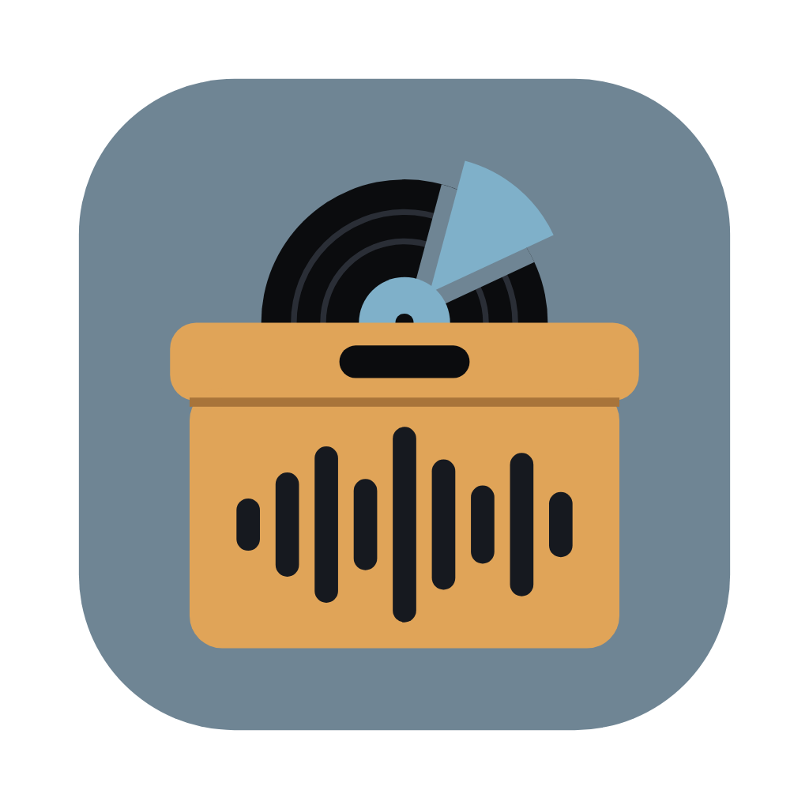
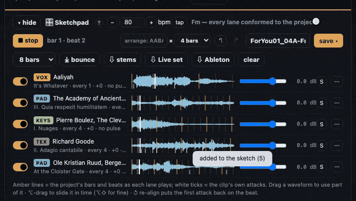
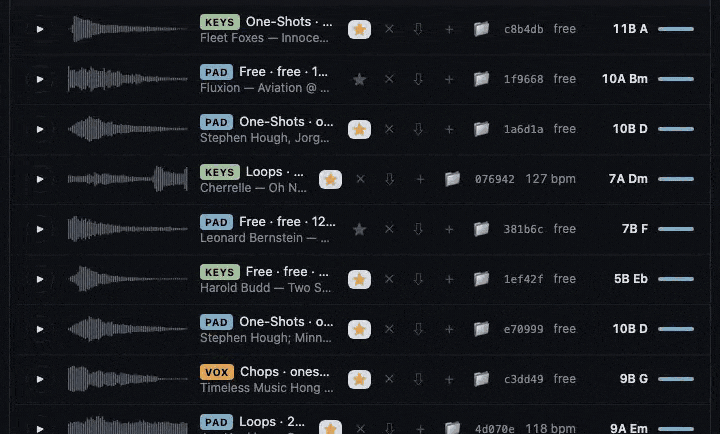
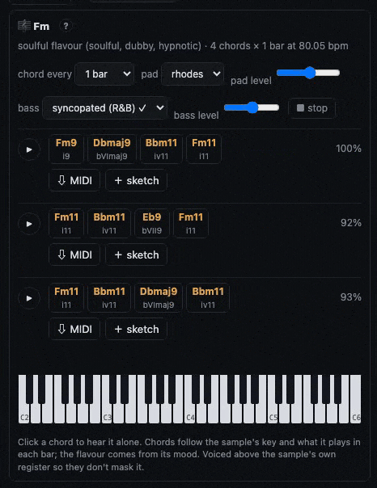
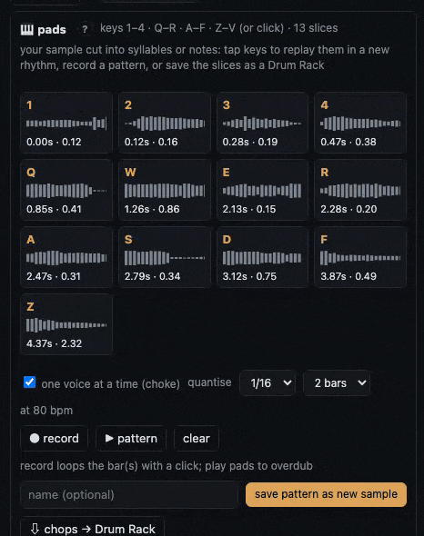
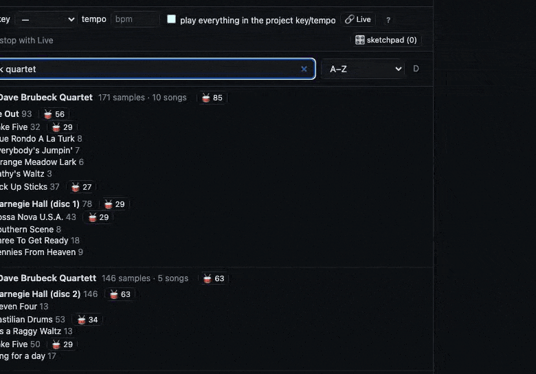

# DigitalCrate



[](https://github.com/jaredhuling/DigitalCrate/actions/workflows/tests.yml)

**Turn your record collection into a playable sample library.** DigitalCrate listens to the music you own, cuts out the
clean moments (exposed vocals, pads, chords, textures, drum hits), tags them by key, tempo, instrument and mood, and
gives you a studio to find, combine and shape them before they go into Ableton Live.


- **Mine** vocals, pads, chords, melodies, textures and drums from your own music.
- **Find** sounds by category, key or mood, by describing them, or by what fits a track you're making.
- **Combine** them in a sketchpad that keeps everything in key and on the grid, with a drum sequencer and chord
  suggestions.
- **Export** to Ableton: organized folders, stems, MIDI, Drum Racks and Live sets.
- **Learn your taste** from stars, skips and listening, and rank what you haven't heard yet.

## Quick start

Mac with Apple Silicon. Paste into Terminal:

```bash
curl -fsSL https://raw.githubusercontent.com/jaredhuling/DigitalCrate/main/install.sh | bash
```

This installs **DigitalCrate** in Applications. The first time you open it, it asks where your music is and mines a
first batch (10 minutes to an hour). Run the command again to update.

<details>
<summary>Install by hand / command line</summary>

```bash
git clone https://github.com/jaredhuling/DigitalCrate.git digitalcrate && cd digitalcrate
uv venv --python 3.11 .venv
uv pip install --python .venv/bin/python --no-deps -r requirements.lock
uv pip install --python .venv/bin/python --no-deps -e .
cp digitalcrate.example.toml digitalcrate.toml      # your music folder, where the library goes

source .venv/bin/activate
digitalcrate scan && digitalcrate scout             # catalog, then rank tracks
digitalcrate process --top 200                      # mine the 200 most promising
digitalcrate build && digitalcrate serve            # → http://localhost:8765
```

`--no-deps` is deliberate: one dependency pins a version that no longer installs. The first run downloads a few GB of
models.
</details>

## Features

### Sketchpad



Layer up to 8 samples in the project key and tempo, with an arrangement, undo, and export as a bounce, stems or an
Ableton Live set.

### Drum lane



A step sequencer for drum hits with velocity, flams, swing, humanize and choke groups. **🔎 complete the kit** finds
hits that sound recorded alike; drum loops slice into pads; export a Drum Rack plus MIDI.

### Chords



Progressions that fit any sample, with a bassline, as MIDI or straight into the sketchpad.

### Pads and Drum Racks



Slice a sample onto keys like an MPC and record a pattern, or open any song's drums as a playable rack.



### And more

- **Search by sound** ("dusty piano chords, melancholy"), by a reference track, or by **🎚 what fits your own track**.
- **✨ Suggested edits** judged by your taste model, and **💡 why this?** on every recommendation.
- **Collections**, **sets** of favorites that fit together, a daily **🎲 Crate**, a **🌌 galaxy** map, lyrics search,
  YouTube scouting, keyboard and MIDI-controller control, undo for everything.

The **[guide](docs/guide.md)** covers every feature, how it works, the command line and configuration.

## Limitations

- **macOS on Apple Silicon only.**
- Built for **Ableton Live 12** (Drum Racks and Live sets use its own templates).
- Separation is very good, not perfect: listen before you commit.
- Local and single-user.

## Tests

```bash
uv pip install --python .venv/bin/python -e ".[dev]"
pytest            # unit tests (seconds)
pytest --slow     # end to end on a synthetic track
pytest --ui       # the app in a real browser (once: playwright install chromium)
```

## Credits and license

Built on [Demucs](https://github.com/facebookresearch/demucs),
[audio-separator](https://github.com/nomadkaraoke/python-audio-separator),
[LAION CLAP](https://github.com/LAION-AI/CLAP), [Essentia](https://essentia.upf.edu), [librosa](https://librosa.org),
[Rubber Band](https://breakfastquay.com/rubberband/), [Signalsmith Stretch](https://signalsmith-audio.co.uk/code/stretch/),
[WORLD](https://github.com/mmorise/World), [OpenVPI vocoders](https://github.com/openvpi/vocoders),
[basic-pitch](https://github.com/spotify/basic-pitch), [aalink](https://github.com/artfwo/aalink),
[yt-dlp](https://github.com/yt-dlp/yt-dlp), [Parselmouth](https://github.com/YannickJadoul/Parselmouth),
[mlx-whisper](https://github.com/ml-explore/mlx-examples), [Beat This!](https://github.com/CPJKU/beat_this),
[Pedalboard](https://github.com/spotify/pedalboard), [MusicBrainz](https://musicbrainz.org) and
[ListenBrainz](https://listenbrainz.org). Model licenses: [`models/README.md`](models/README.md).

**License:** [AGPL-3.0](LICENSE) (Essentia is AGPL-3.0).

**On sampling:** this tool helps you find material; it doesn't clear it. Releasing music with a sample is your call,
and often a conversation with the rights holder.
