# DigitalCrate

**Turn your record collection into a playable, searchable sample library.** DigitalCrate listens to every track
you own, cuts out the *clean* moments (exposed vocals, pads, chords, textures, drum hits), and tags each one with
key, tempo, instrument and mood. It then gives you a browser-based studio for finding, auditioning, combining and
reshaping those sounds before you drop them into Ableton Live.

It was built for making slow, hazy, voice-haunted electronic music (think Gas, Burial or Grouper fed through a techno
lens), but nothing in it is genre-specific.

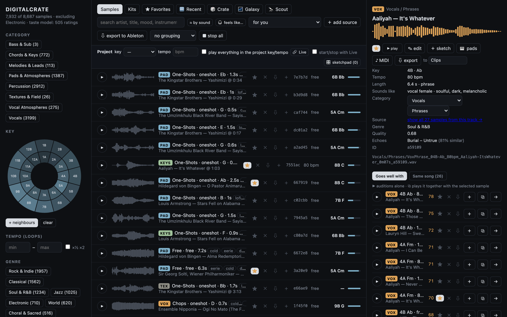

---

- [What it does](#what-it-does)
- [Quick start](#quick-start)
- [How it works](#how-it-works)
- [A tour of the app](#a-tour-of-the-app)
- [Command line](#command-line)
- [The library on disk](#the-library-on-disk)
- [Configuration](#configuration)
- [Limitations](#limitations)
- [Credits and licences](#credits-and-licences)

---

## What it does

- **Mines** vocal phrases, vocal chops, choirs, pads, chords, melodies, textures, field recordings and percussion
  (one-shots, combined strikes and loops) from your own music. It separates stems only when it needs to, and keeps
  only what is clean.
- **Organises** every sample by Camelot key, tempo, category, instrument, mood and genre. The file names carry all of
  this, so Ableton's own browser search works on them.
- **Learns your taste.** Stars, skips and listening time train a model that ranks what you haven't heard yet.
- **Searches by sound.** You can type a description ("lonely female voice, distant, rainy night") or name a reference
  track ("feels like Burial – Archangel").
- **Shows the whole library on a map** (the "galaxy"), where nearby points sound alike.
- **Conforms to your project.** Set a key and tempo, and every preview is retuned and time-stretched to fit. It also
  follows Ableton Live's tempo over Link.
- **Works like a small studio:**
  - a sketchpad to layer up to 8 samples in time;
  - playable pads built from a sample's syllables;
  - audio-to-MIDI;
  - vocal re-tuning with natural glide and drift;
  - a non-destructive editor;
  - generative "mangle" variations.
- **Exports to Ableton:** organised sample folders, key/tempo-conformed copies, MIDI files, and ready-made
  **Drum Racks** (`.adg`).
- **Scouts YouTube for raw singing.** It listens to a minute of each search result and ranks it for clean,
  unaccompanied voice.
- **Ships a blind A/B shootout** for comparing time-stretch and pitch-shift engines on your own material.

## Quick start

**Requirements:**

- macOS on Apple Silicon. This is the only setup it has been tested on (an M4 with macOS 15). Linux will probably
  work, apart from the Ableton-specific parts (export paths, the Drum Rack template); Windows is untested.
- Python 3.11.
- Homebrew packages: `ffmpeg` and `rubberband` (`brew install ffmpeg rubberband`).
- Optional:
  - `deno` (yt-dlp uses it for YouTube);
  - Ableton Live 12 (the Drum Rack template is read from the app bundle);
  - Playwright (only for regenerating the screenshots).

```bash
git clone <this repo> digitalcrate && cd digitalcrate
uv venv --python 3.11 .venv            # or: python3.11 -m venv .venv
uv pip install --python .venv/bin/python --no-deps -r requirements.lock   # exact tested set
uv pip install --python .venv/bin/python --no-deps -e .                   # adds the `digitalcrate` command

cp digitalcrate.example.toml digitalcrate.toml       # then edit: where your music is, where the library goes
```

`requirements.lock` is installed with `--no-deps` on purpose: basic-pitch declares `resampy<0.4.3`, but that
version breaks on current setuptools, so a normal resolver can't install the set that actually works. Install it
editable (`-e .`): the app looks for `digitalcrate.toml` and `models/` next to the code.

```bash
source .venv/bin/activate
digitalcrate scan                      # catalogue your music (tags only, fast, incremental)
digitalcrate scout                     # rank tracks by how sample-worthy they sound (needed for --top)
digitalcrate process --top 200         # mine the 200 most promising tracks
digitalcrate drums --top 100           # mine percussion from the best tracks with live drummers
digitalcrate build                     # tags, compatibility, kits, folder views, browser
digitalcrate serve                     # → http://localhost:8765
```

**Notes:**

- `digitalcrate` and `python -m digitalcrate` are the same thing.
- To skip the scout, pick tracks yourself: `process --artist "Marvin Gaye" "Aaliyah"`, `--match <path part>`,
  `--genre <tag>` or `--all`.
- The first run downloads the models (Demucs, RoFormer, CLAP; a few GB) into the Hugging Face and torch caches.
- Processing is resumable. Tracks that are already done are skipped.
- Duplicate files (the same recording under two names or albums) are mined once. A match needs the same artist
  and title, the same length, and the same loudness envelope, so different movements that share a title like
  "III. Adagio" are kept apart.
- On a Mac, wrap long runs in `caffeinate -i` so the machine doesn't sleep.
- Rough speed on an M4: 25–40 s per track with Demucs stems, about 2 min with the RoFormer vocal model, and
  8–12 s when no separation is needed.

## How it works

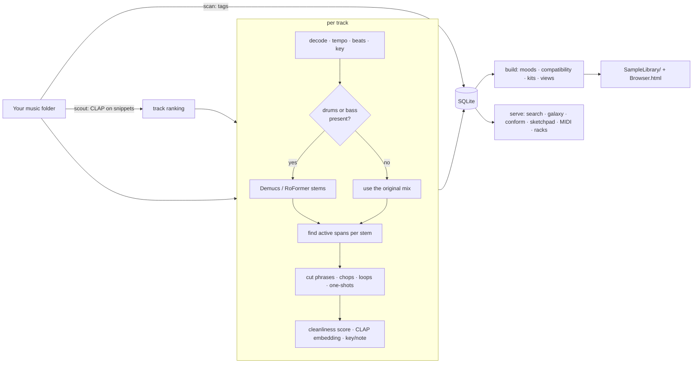

### 1. Mining clean samples (`process.py`, `extract.py`, `analyze.py`)

1. **Analyse the track.** Each track is decoded with ffmpeg and analysed with Essentia for tempo, beat grid and key.
2. **Separate stems only when needed.** If the track has drums or bass, it is split into stems with **Demucs**
   `htdemucs` (optionally a **MelBand RoFormer** model for much cleaner vocals). A drumless ambient track is left
   untouched, because the original audio always sounds best.
3. **Find where each stem is active.** For every frame, the loudness of each stem is compared with the mix. This
   shows where a voice or pad is present and where drums and bass are bleeding in.
4. **Cut candidates:**
   - vocal phrases (bounded by natural silences);
   - syllable-length vocal chops;
   - bar-aligned 2/4/8-bar loops of pads, chords and melodies;
   - free-length windows when there's no steady tempo;
   - isolated one-shots;
   - "vocal atmospheres", where voice and pad overlap with no drums underneath.

   If a stem is effectively alone in the mix for a span, the **original mix** is rendered instead of the separated
   stem, which avoids separation artifacts.
5. **Score cleanliness (0–1)** from five signals:
   - drum level during the span;
   - how dominant the stem is (a weak stem means more artifacts);
   - residual percussiveness;
   - loudness;
   - CLAP's "this sounds like drums" probability.

   Only samples scoring ≥ 0.40 are kept, and repeated choruses are de-duplicated.
6. **Describe each sample with CLAP.** Every sample is embedded with **CLAP** (LAION's music-and-speech model), which
   gives an instrument class, mood similarities and the 512-number "fingerprint" behind search, the galaxy and the
   taste model. Each sample also gets its own key (chroma) and, for one-shots, its root note.

**Percussion** (`percussion.py`) follows its own pipeline:

1. Demucs separates the drums stem.
2. **MDX23C DrumSep** labels each hit (kick / snare / toms / hats / ride / crash).
3. CLAP refines the labels (tom vs hand drum, snare vs rim/clap, hat vs shaker).
4. The output is one-shots, including clean combined strikes like snare+hat, plus 1/2/4-bar loops: Breaks, Full Kit,
   Tops and Percussion, with swing measured.

### 2. Source policy (`policy.py`)

Sampling a record that is itself built from samples just recycles someone else's crate, so every artist falls into
one of three groups:

| Policy | Meaning |
|---|---|
| `reference` | Sample-based producers (Burial, Gas, Madlib, J Dilla…). **Never** enter the library. Their sounds go to `_Reference/` and are used only as *style queries*. |
| `vocals_only` | The vocal is original but the beat is sampled (most hip-hop). Only vocals are mined. |
| `source` | Everything else: fair game. |

You can extend the lists in `digitalcrate.toml`.

### 3. Compatibility, kits and moods (`build.py`)

For every pair of samples, a compatibility score is the product of three parts:

- **harmony:** distance on the Camelot wheel plus chroma overlap;
- **tempo:** loops only, allowing ½× and 2×;
- **arrangement fit:** whether the two samples play compatible roles, combined with how similar they sound in CLAP.

The detail panel's "goes well with" list comes from this score, and so do the auto-generated **kits** (a vocal plus
pads, keys, a texture and a chop that fit together). Mood tags (dark, ethereal, eerie, soulful, dubby, nocturnal…)
come from CLAP text similarity.

### 4. The taste model (`taste.py`)

What you do in the app is logged as feedback: stars, ✕ (dislike), listening time, and which variations you keep.
Two models learn from it:

- **What sounds you like:** a Bayesian logistic regression on PCA-reduced CLAP embeddings. It gives a score *and* an
  uncertainty for every sample, and the uncertainty is used for exploration. It is blended with a *multi-mood*
  nearest-favourite similarity, because a taste is several moods, not one average. Unrated samples count as weak
  negatives.
- **Which manipulations you like:** a Beta posterior for each technique, which steers the `mangle` variation
  generator.

`python -m digitalcrate taste` reports held-out accuracy.

### 5. Searching by sound (`search.py`)

Every sample has a CLAP embedding. CLAP is trained on millions of sound/description pairs, so sounds that are alike,
or would be described with the same words, end up close together.

**Text search** ("≈ by sound"):

1. The query is split on commas, and each part is embedded as text.
2. Every sample gets a similarity score for each part.
3. The parts are combined with a soft AND (mean minus a penalty for disagreement), so a result has to match *all* of
   them.
4. Words naming a source ("piano", "choir"…) count double, and category words nudge matching categories up.
5. `-word` pushes results away from that word.

**Reference search** ("🎧 feels like…") takes a YouTube URL, a file, or "artist – title" from your library:

1. The reference is cut into up to 36 ten-second windows, and each window is embedded.
2. Each sample's score is 60% its similarity to the *single best-matching moment* and 40% its similarity to the
   reference's *overall average*. The first part finds things like a specific vocal break; the second captures the
   track's general colour. The app shows which moment matched ("like the reference @ 1:42").
3. Cuts of the reference itself and reference-only artists are excluded.

CLAP captures timbre, space, texture and mood. It does **not** capture key, tempo or melody; project mode handles
those.

### 6. The galaxy (`search.py`)

The 512-number embeddings are reduced to 50 dimensions with PCA, then laid out in 2-D with **t-SNE** and cached.

- **Neighbourhoods are meaningful:** points next to each other sound alike, and clusters are real families of sounds.
- **Long distances are not:** the distance between two far-apart clusters means little.
- **Colours don't affect positions:** colours show category or the taste model, and favourites are ringed.

### 7. Conforming to a project (`conform.py`)

Given a project key and tempo:

- **Pitch:** a sample is shifted by the **smallest** interval that lands it on the project key (−6…+5 semitones). A
  major/minor mismatch targets the relative key.
- **Tempo:** only loops are time-stretched, to whichever of ½×, 1× or 2× of the project tempo is nearest. Phrases and
  one-shots keep their natural timing.
- **Engines** were chosen by a blind listening test ([the shootout](#stretch--repitch-shootout)). Samples that aren't
  stretched (phrases, chops, one-shots, free pads) are **Re-Pitched**: tape-style resampling with no processing
  artifacts, so a sample shifted up gets slightly shorter. Loops use **Signalsmith Stretch**, which keeps them
  bar-exact.
- **Caching:** results are cached, so a conformed preview plays instantly the second time.

Large shifts still degrade any engine, which is why the shift is always the smallest one that fits.

### 8. Variations (`transform.py`, `mangle.py`)

`mangle` profiles each sample by material, length, attack density and brightness. It then draws a *random* chain from
technique families suited to that material, with the choice biased by the technique-taste model:

- stretch, smear and freeze;
- phase loops;
- tape;
- "zauberberg" haze;
- groove chops.

Every render stores its exact chain, so a good one can be reproduced. In the browser, ←/→ steps through a sample's
variations.

## A tour of the app

Start the server with `python -m digitalcrate serve` and open http://localhost:8765. Everything in this tour runs locally.

### Browse

The **left sidebar** filters by category, key (click the Camelot wheel; "+ neighbours" adds compatible keys), tempo,
kind, mood and genre. Genres can be excluded as well as included.

**Sorting options:**

- **Diverse:** the best of each artist in turn.
- **For you:** the taste model's ranking.
- **Today's vibe:** weighted towards recent ratings.
- **Discover:** high-uncertainty picks.
- **Quality.**

**Rows:**

- ▶ plays the sample.
- ★ and ✕ train the taste model.
- ⇩ exports to Ableton.
- ＋ adds the sample to the sketchpad.
- Clicking the ID copies it, ready to paste into Ableton's search.

**The detail panel** (right):

- **Goes well with:** compatible samples, scored. ⧉ plays one *together* with the selected sample.
- **Same song:** every cut from that track, in song order.
- **Echoes:** the closest reference-artist sound.
- **Category:** can be corrected. Corrections survive reprocessing.

### Search by description: ≈ by sound


Toggle **≈ by sound**, describe what you want, and press Enter. Results come back closest first, and your other
filters still apply.

### Search by reference track: 🎧 feels like…

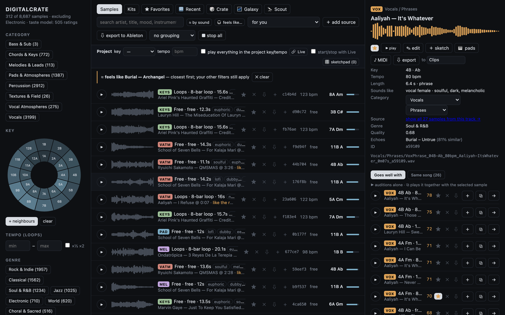

Give it a YouTube URL, a file path, or "artist – title" from your collection. It finds the samples that sound most
like the track. In this example: warm, reverb-soaked keys and voice-in-a-haze atmospheres from Ariel Pink, Lauryn
Hill, School of Seven Bells and Ryuichi Sakamoto. Nothing from the reference is ever sampled.

### Project mode and Ableton Link

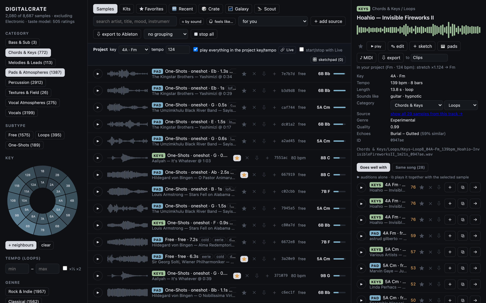

Set a **key and tempo** and tick *play everything in the project key/tempo*. Every preview, variation and "play
together" is then conformed, and the detail panel tells you what will happen (here: "stretch ×1.291 → Fm").

**🔗 Live** joins Ableton Link (`link.py`, via `aalink`). With Link enabled in Live:

- the project follows Live's tempo;
- the sketchpad starts on Live's next bar;
- with *start/stop with Live* ticked, the sketchpad also follows Live's transport.

### Sketchpad

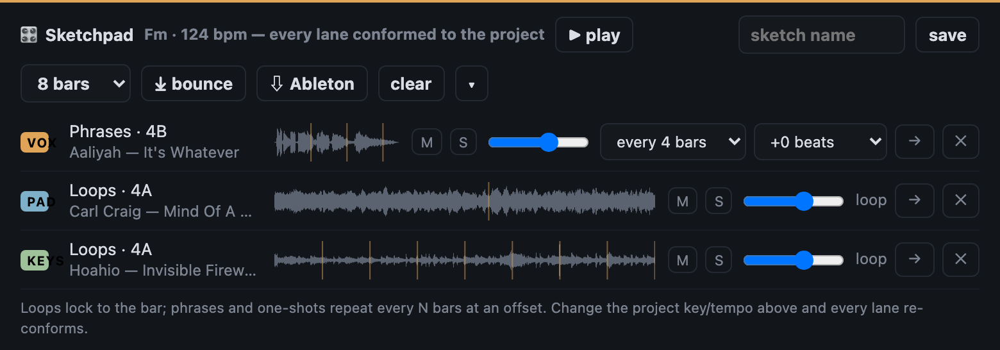

Press **＋** on any sample to drop it into a lane (up to 8). How each lane plays:

- **Loops** lock to the bar.
- **Phrases and one-shots** repeat every N bars at a beat offset.
- Each lane has mute, solo and volume.

Changing the project key or tempo re-conforms every lane.

**Outputs:**

- **Save** a sketch. It appears in Kits → *Your sketches*.
- **Bounce** N bars to a new sample. Its provenance is kept and it's auto-starred.
- **Send to Ableton** as conformed files plus a Drum Rack.

Any auto-generated kit also opens straight into the sketchpad.

### Pads

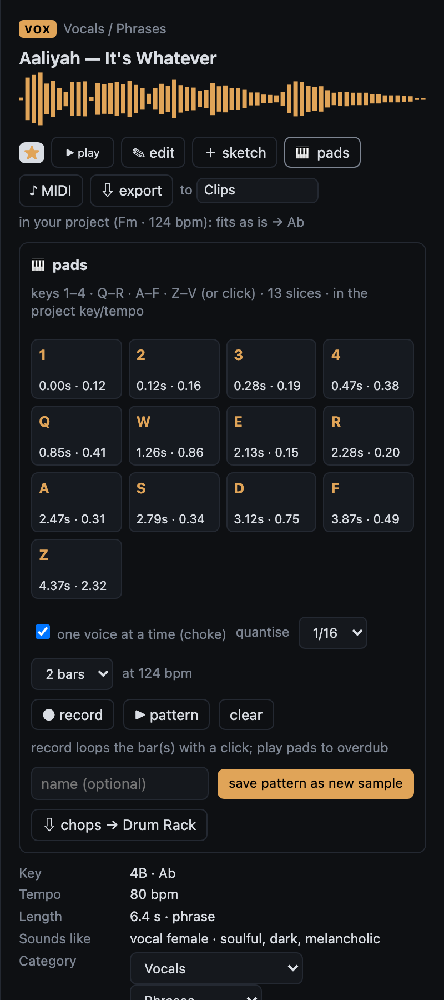

**🎹 pads** slices a sample at its syllables or notes and puts the slices on the keyboard: `1–4`, `Q–R`, `A–F`, `Z–V`.

- **Choke:** one voice at a time.
- **Quantise:** to 1/4, 1/8 or 1/16.
- **Record:** records or overdubs a 1–4 bar pattern over a click.

**Outputs:**

- **Save pattern as new sample.**
- **Chops → Drum Rack:** exports the slices as an Ableton Drum Rack.

### Audio to MIDI

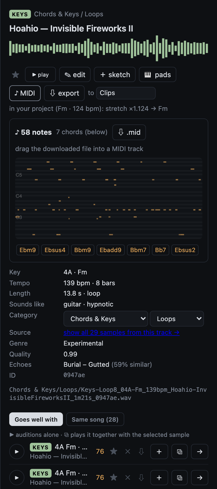

**♪ MIDI** transcribes notes with Spotify's **basic-pitch**, shows a piano roll, names the chords, and gives you a
`.mid` file (at the project tempo when one is set). The export dialog can add MIDI files next to every tonal sample.

### Editor and vocal tuning

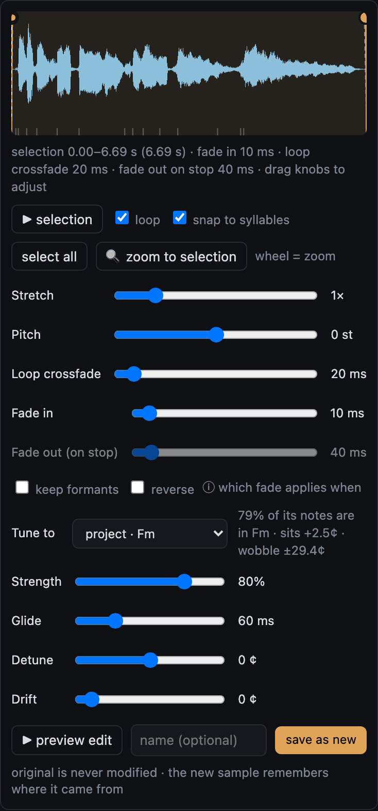

**✎ edit** opens a non-destructive editor:

- selection snaps to syllables;
- stretch and pitch, with formant preservation;
- reverse;
- fades and loop crossfades with draggable handles;
- live preview.

**Tune to** (`retune.py`) pulls a vocal toward a key:

1. A pYIN pitch track finds the notes.
2. Each note gets a correction:
   - **strength** sets how far it's pulled;
   - **glide** sets how hard or natural the pull is (hard is the Auto-Tune effect);
   - **detune** and slow **drift** add back human looseness.
3. The corrections are applied as tape-style variable speed: the playback rate follows the pitch curve, so nothing is
   resynthesised. Corrections are under half a semitone, so timing moves by 3% at most. This engine won the blind
   tuning test below.

The panel reports how in-key the take already is.

*Save as new* writes to `Edits/` and records the parent sample and the exact operations. The original is never
touched.

### 🎲 Crate

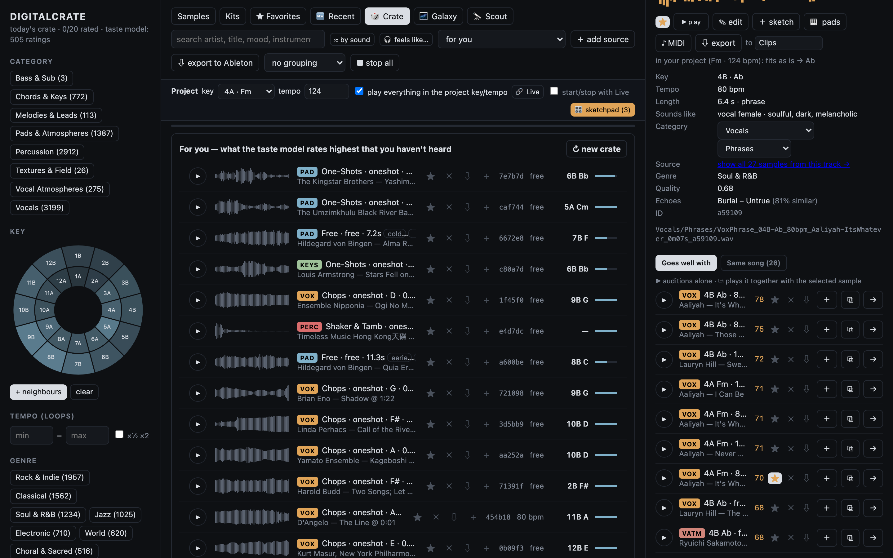

A daily dig: 14 samples the taste model rates highest that you haven't heard yet, plus 6 wildcards. At most one per
track and two per artist, and it never repeats.

### 🌌 Galaxy


Every sample on a map arranged by sound (see [how it works](#6-the-galaxy-searchpy)).

- Hover to hear a sample, click to open it.
- Wheel zooms, drag pans.
- *Show taste* colours each point by how much the model thinks you'll like it.

Warm patches in places you've never explored are good places to dig.

### 🔭 Scout: raw singing from YouTube

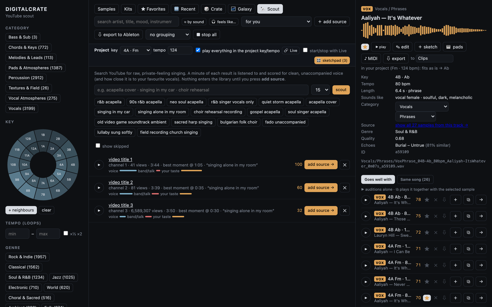

Pick a preset ("singing in my car", "choir rehearsal recording", "sacred harp singing"…) or type a query.

1. The scout downloads about 60 seconds of each result.
2. CLAP scores every 10-second window for clean unaccompanied voice, against full-band music, speech and crowd noise.
3. It also scores closeness to your favourite vocals.
4. It keeps a 10-second preview of the best moment.

**Nothing enters the library until you press "add source".** In the example, a bedroom recording with 41 views
outranks a karaoke backing track with 6.5 million.

### Kits, Recent, Favourites

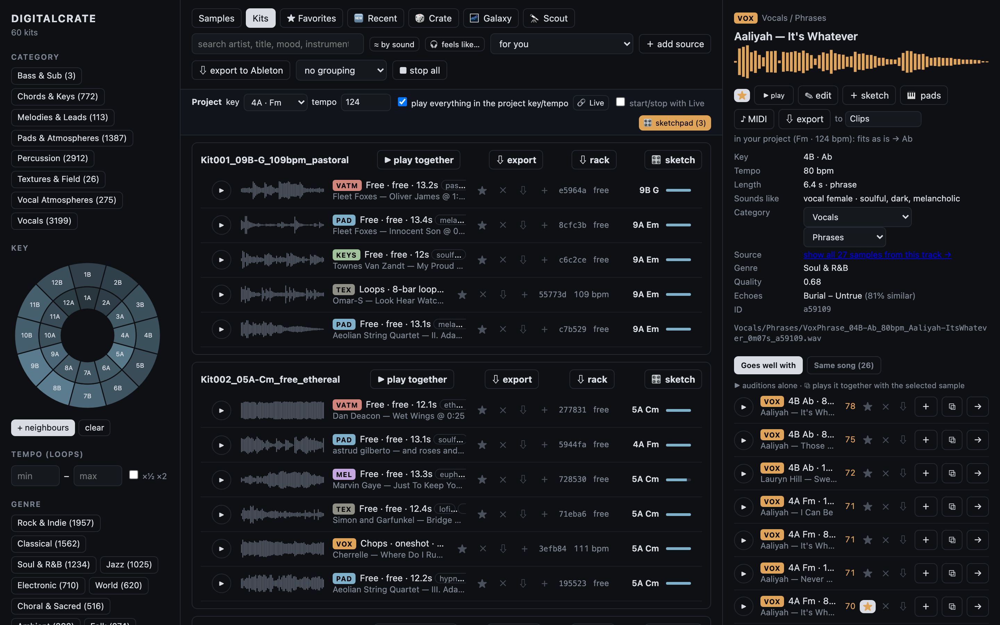

- **Kits** are groups of samples that fit together. Each one can be exported (⇩), turned into a Drum Rack (⇩ rack),
  or opened in the sketchpad.
- **Recent** shows the newest additions: ingests, edits and bounces.

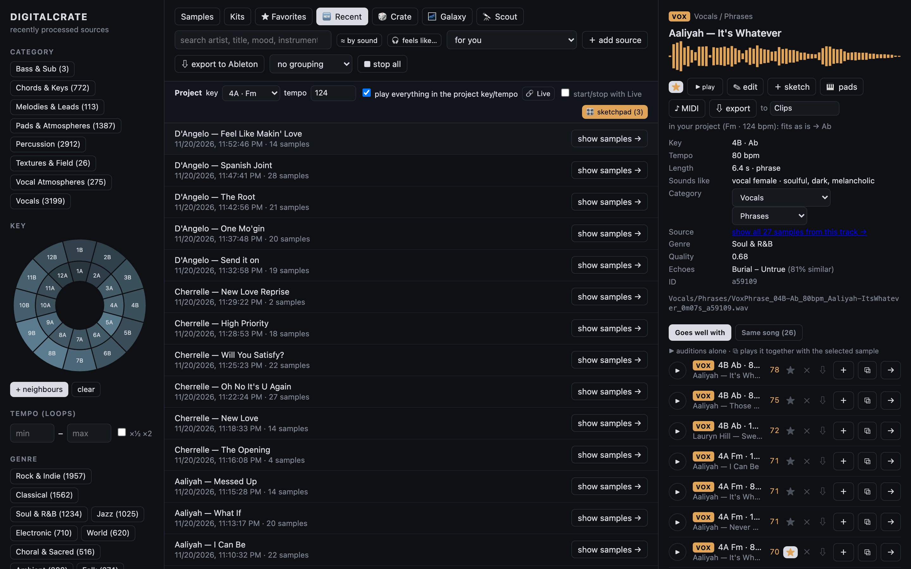

### Exporting to Ableton

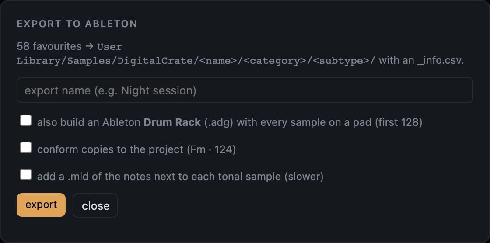

Exports are copied into `Ableton User Library/Samples/DigitalCrate/<name>/<Category>/<Subtype>/`, with an `_info.csv`
(key, tempo, bars, source track and timestamp, provenance). Options:

- **Drum Rack:** a `.adg` with one pad per sample, starting at C1. It's built from Live 12's own factory Drum Rack
  as a template, so the XML matches what Live expects.
- **Conform:** copies retuned and stretched to the project key and tempo.
- **MIDI:** `.mid` files next to tonal samples.

The same export works from the CLI: `python -m digitalcrate export --favorites --rack --key Fm --bpm 124`.

### Stretch & repitch shootout

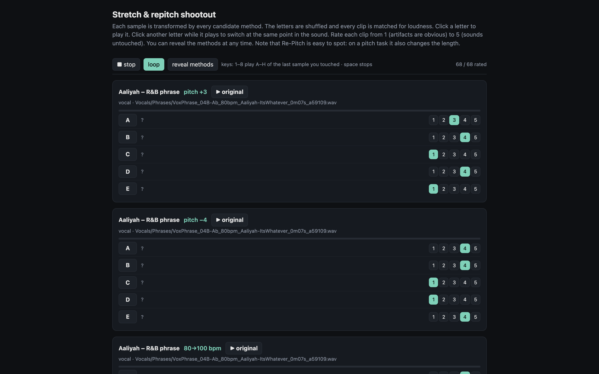

Every pitch shifter and time-stretcher leaves artifacts at some point. Which one is best depends on the material, so
there's a blind listening test at http://localhost:8765/shootout.

Each sample and task (+3 / −4 semitones, 80→100 bpm, half speed…) is rendered by every candidate method:

| Method | What it is | Used on |
|---|---|---|
| Rubber Band R3 | high-quality phase vocoder, optional formant preservation | all |
| Rubber Band R2 percussive | transient-focused settings | drums |
| Signalsmith Stretch | modern open-source stretcher | all |
| Varispeed / Re-Pitch | plain resampling: pitch and tempo move together, no processing at all | all |
| WORLD vocoder | analyse pitch + spectral envelope, resynthesise | monophonic voice |
| Neural vocoder (PC-NSF-HiFiGAN) | mel spectrogram + new pitch curve → waveform | monophonic voice |
| Granular | overlapping windowed grains | pads, keys |
| Slice & re-place | cut at each hit, move hits to the new grid, never stretch | drums |

How the test works:

- Clips are **loudness-matched** and the letters are shuffled.
- Clicking another letter while one plays switches at the same point in the sound.
- You rate each clip 1–5. `python -m digitalcrate shootout --results` tallies the averages per material.

**The first run** (68 clips, rated blind, one listener) produced these averages:

| Material | Re-Pitch | Signalsmith | Rubber Band R3 | Other |
|---|---|---|---|---|
| Vocals | **3.9** (pitch only: **4.3**) | **3.9** | 1.9 | neural vocoder 2.0, WORLD 1.0 |
| Pads | 3.0 | 3.5 | **4.0** | granular 1.0 |
| Keys | **5.0** | 4.0 | 4.0 | granular 1.0 |
| Melodic loops | 3.5 | **4.5** | **4.5** | |
| Drums | 3.0 | **4.5** | **4.5** | R2 percussive 3.0, slice 3.0 (1 and 5) |

Signalsmith never scored below 3. Rubber Band's formant-preserving mode was the clear loser on voice. Re-Pitch is
best whenever the length is allowed to change. Those results are the current defaults (`digitalcrate/stretch.py`).

**The tuning round** (`shootout --tune`, http://localhost:8765/shootout?round=tune) compares engines that follow a
time-varying pitch curve. There are 5 vocal phrases, each at two settings: natural (80% strength, 60 ms glide) and
hard (100%, instant). The **untouched original is hidden among the letters** as a control.

| Engine | Natural | Hard |
|---|---|---|
| Original (control) | 4.2 | 4.4 |
| Tape-style variable speed | **4.6** | 1.6 |
| Rubber Band R3 | 3.4 | 1.6 |
| Rubber Band R3 + formants | 3.2 | 1.6 |
| Praat PSOLA | 2.4 | 1.6 |

At the natural setting, variable speed scored as high as the untouched original, which means it was inaudible. At the
hard setting every engine scored 1.6. The problem there is the snap itself, not the engine. Variable speed is now the
Tune engine, and natural is the default setting.

## Command line

```text
python -m digitalcrate <command>

scan [--root DIR]            catalogue the music folder (or an extra folder)
policy                       apply the source policy to all tracks
scout                        rank tracks for sample-worthy material (fast, CLAP on snippets)
process [filters] [opts]     mine samples
    --artist A B  --match S  --genre G  --all  --top N  --limit N
    --separate auto|always|never   --vocals roformer|bleedless   --reprocess  --reference
drums --top N                mine percussion
build                        moods, compatibility, kits, key/tempo folders, Browser.html
status                       progress summary
serve [--port 8765]          the app
taste                        fit the taste model, report accuracy
transform / mangle --ids …   render variations
ingest URL|FILE|FOLDER [--drums]    add a source (YouTube via yt-dlp) and mine it
export --favorites|--kit K|--ids … [--name N] [--rack] [--key Fm --bpm 124]
reclassify                   re-apply category rules (no audio work)
ytscout "query" [--n 15]     YouTube scout
shootout [--force|--results|--tune]  render / tally the stretch (or vocal tuning) shootout
```

## The library on disk

```
SampleLibrary/
  Vocals/{Phrases,Chops,Choir & Group,Spoken}
  Vocal Atmospheres/{Loops,Free}
  Pads & Atmospheres/{Loops,Free,One-Shots}
  Chords & Keys/…  Melodies & Leads/…  Textures & Field/…  Bass & Sub/…  Percussion/…
  Edits/…                         your edits, bounces and pad patterns
  Favorites/<category>/…           hardlinks to starred samples
  _By Key/08A Am/<category>/…      hardlinks (no extra disk space)
  _By Tempo/135-139 bpm/<category>/…
  Kits/Kit001_05A-Cm_136bpm_eerie/
  _Reference/                      reference-only artists (style queries, never exported)
  Browser.html
  _data/samples.sqlite             everything: tracks, samples, embeddings, ratings, sketches
```

File names carry everything Ableton's search needs. For example,
`VoxChop_05A-Cm-Ab_136bpm_Artist-Title_1m42s_ae127b.wav` is a vocal chop from a track in C minor (Camelot 5A). Its
own note is A♭, the track runs at 136 bpm, and the chop was cut at 1:42. `ae127b` is the sample's unique ID.

In Ableton, open the Browser and go to *Places → Add Folder…* to add the library. Loops are bar-exact, so Live's
auto-warp locks them to tempo.

## Configuration

- **Paths** live in `digitalcrate.toml` (see `digitalcrate.example.toml`), or in the environment variables `DIGITALCRATE_MUSIC`,
  `DIGITALCRATE_LIBRARY`, `DIGITALCRATE_FOUND` and `DIGITALCRATE_ABLETON_SAMPLES`.
- **Detection thresholds and per-track caps** are in `digitalcrate/config.py`.
- **Reference-only artists** go in `digitalcrate/policy.py`, plus `reference_artists` in `digitalcrate.toml`.
- **Genres:** each track gets one family (Ambient, Electronic, Soul & R&B, Jazz…), which is used for the genre
  filter and for choosing drum sources. File tags are often wrong ("Blues" on a dub techno record), so the evidence
  is weighed in this order:
  1. your `[genres]` table in `digitalcrate.toml` (artist = family);
  2. the track's tag, read by keyword, with Ambient and Electronic winning in compound tags ("Disco/Deep House/Funk");
  3. the artist's most common family across your whole collection, for untagged tracks;
  4. a CLAP guess from the track's samples, as a last resort. It is weak, because samples are stems and fragments.

  After editing `[genres]`, run `digitalcrate build`.
- **Models** are listed in [`models/README.md`](models/README.md).
- **Screenshots** are regenerated with `tools/screenshots.py` (Playwright) while the server is running.

## Tests

```bash
uv pip install --python .venv/bin/python pytest
pytest                 # fast: genre mapping, key parsing, the stretch and tuning engines (a few seconds)
pytest --slow          # also end to end on a synthetic track: scan, process, build, serve (about 20 s once models are cached)
```

The end-to-end test runs in a throwaway library and never touches your real one.

## Limitations

- The Ableton integration was developed against **Live 12**. Drum Racks are generated from its factory rack, and
  older versions may refuse them.
- Ableton Link is implemented with `aalink`, but syncing with a running Live set needs more real-world testing.
- Separation is very good but not perfect. The cleanliness score filters out most bleed; listen before you commit.
- CLAP search understands timbre and mood, not key, tempo or melody.
- Everything is single-user and local. The server binds to `127.0.0.1` only.

## Credits and licences

Built on:

- [Demucs](https://github.com/facebookresearch/demucs)
- [audio-separator](https://github.com/nomadkaraoke/python-audio-separator) (MelBand RoFormer, MDX23C DrumSep)
- [LAION CLAP](https://github.com/LAION-AI/CLAP) via Hugging Face transformers
- [Essentia](https://essentia.upf.edu)
- [librosa](https://librosa.org)
- [Rubber Band](https://breakfastquay.com/rubberband/)
- [Signalsmith Stretch](https://signalsmith-audio.co.uk/code/stretch/)
- [WORLD](https://github.com/mmorise/World)
- [OpenVPI vocoders](https://github.com/openvpi/vocoders) (CC BY-NC-SA 4.0, non-commercial)
- [basic-pitch](https://github.com/spotify/basic-pitch)
- [aalink](https://github.com/artfwo/aalink)
- [yt-dlp](https://github.com/yt-dlp/yt-dlp)
- [Praat](https://www.fon.hum.uva.nl/praat/) via [Parselmouth](https://github.com/YannickJadoul/Parselmouth) (shootout only)

See [`models/README.md`](models/README.md) for model licences.

**Licence:** [AGPL-3.0](LICENSE). Essentia, which provides key, tempo and beat tracking, is AGPL-3.0, and several
other dependencies (Rubber Band, aalink, mutagen, Parselmouth) are GPL. That rules out a permissive licence for
this repo as long as it depends on them.

**On sampling:** this tool helps you find material; it doesn't clear it. Whether and how you can release music that
uses a sample depends on where it came from. That's your call, and often a conversation with the rights holder.
