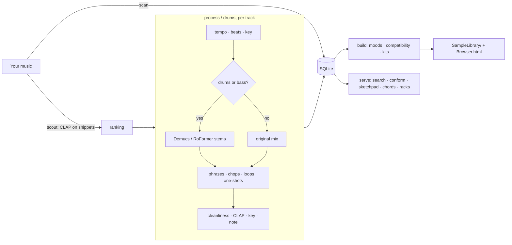

# DigitalCrate guide

Everything the [README](../README.md) skips. The small **?** buttons in the app explain features in place too.

- [Browse](#browse) · [Sketchpad](#sketchpad) · [Drum lane](#drum-lane) · [Chords](#chords) · [Pads](#pads) ·
  [Drum Racks from songs](#drum-racks-from-songs) · [Search](#search) · [Editing](#editing) · [Taste](#taste) ·
  [Scout](#scout) · [Organizing](#organizing) · [Mining](#mining-and-sources) · [Export](#export) · [Keyboard and MIDI](#keyboard-and-midi) ·
  [How it works](#how-it-works) · [Command line](#command-line) · [Library on disk](#the-library-on-disk) ·
  [Configuration](#configuration)

## Browse

- **Tabs** for each category (with counts), **🎲 Crate**, an **Artists** view (artist → album → song), and filters for
  *this track · this album · this artist* in the sample panel.
- **★** keeps a sample (linked into `Favorites/`); **✕** means *not for me*: it disappears and teaches the taste model.
- **🗑 delete** removes a sample; *Same song* deletes everything cut from a song (favorites and edits are kept).
  Deleted files go to a trash folder until `digitalcrate trash --empty`.
- **Goes well with** lists partners scored on key (Camelot wheel and the notes actually played), tempo, role and sound.
  **⧉** plays a pair together, **💾** saves it as a sketch.
- **🕘 Recent actions** lists every ★, ✕, category move, collection change and delete, each with undo.
- **Added recently** narrows any sort to the latest run, day or week.
- **∞ hold** on a pad, drone or held chord plays it and holds it on its seamless loop until you stop it.
- **🔁 takes:** a sample that comes round again in its song (the same drum hit, the same sung words, the same chord)
  is grouped with its other takes. Click the tag on a row to hear them back to back; the sample panel lists them with
  **▶ play all**, and **T** steps to the next take.
- **Pads** are sounds that hold one or two chords and keep still, so they loop and can be played. Sustained samples
  that move through more chords live in **Strings & Orchestral** (orchestral passages) or **Chords & Keys** (synth
  progressions); one-shots that die away (a struck key, a pluck) are in Chords & Keys. The panel shows a sample's own
  chords (*Fm → D♭*).
- **🎹 playable** (pads, strings, chords) makes an instrument for Live in `Playable pads/`: a Simpler preset tuned to
  the sample's chord, so each key plays it from that note and holds it on its loop, plus its chords as a MIDI clip to
  start from. **♪ MIDI** transcribes its actual notes.
- **Sections:** with song sections found, a filter picks samples from the intro, verse, chorus, a break or the
  outro (*intro · break · outro* are where songs are most exposed), and the panel says where a sample comes from.
- **Drag** any row into Live or Finder; **↗ Finder** shows the file.

## Sketchpad

Up to 8 lanes, in the project key and tempo. Open a kit in it or add samples with **＋**.

- **Timing:** amber lines are the project's bars and beats; white ticks are the clip's attacks. Rhythmic clips can
  **⟷ match tempo**; **↺ re-align** puts a selection's first attack on the beat; ⌥-drag slides a lane.
- **Per lane:** trim, on/off, solo, fades, repeat every N bars, keep its own key, and a relative fader (all start at 0 dB).
- **∞ hold** (in a lane's ⋯) sustains a pad on its loop for the whole repeat length, so a 3-second pad becomes a
  4-bar bed.
- **Tempo:** − / +, type it, or tap.
- **Arrangement:** type sections (`AABA`) and their length, then tick the sections each lane plays in.
- **Undo:** ↶ ↷ (⌘Z / ⌘⇧Z). **save •** turns amber with unsaved changes (⌘S). The sketch survives a refresh.
- **▾ hide** keeps it playing behind a small bar; samples you play are heard over it.
- **Out:** save, bounce to a new sample, **⇩ stems** (one WAV per lane, aligned from bar 1), or **⇩ Live set**
  (one track per lane, clips where it plays).
- **Kits** are dealt for you: a vocal the taste model likes, plus parts from other songs that fit it. **↻ new kits**
  deals again.

## Drum lane

Drum one-shots you add become pads in a step sequencer (16 steps a bar, 1 or 2 bars).

- **Steps:** click for on → soft → off; scroll for exact velocity; ⌥-click for a flam.
- **Feel:** swing, humanize, and choke groups (closed hat cuts off open hat).
- **🔁 takes** (round robin): a pad alternates between other hits of the same drum from the same song, so repeated
  hits sound played rather than copied. The rack export puts each take on its own pad and the MIDI follows the
  same order.
  - By default the takes play **in turn** (main, 2, 3, main…). **Shuffled** plays every take once in a random order,
    then a new order, never the same take twice running; 🎲 gives a different shuffle. Both play the same way every
    time, so bounces and exports match what you heard.
  - **⇧-click a step** to pin it to one take (the step shows its number); ⇧-click again to move on, back to auto.
  - The takes row under the pad plays each take (▶ 1, ▶ 2…), and **★** makes one the main hit. 🔁 shows or hides
    the row; **off** goes back to one take.
- **✨ starter** writes a pattern from the pad types.
- **🔎 complete the kit** suggests hits for the kinds you're missing that sound recorded alike (it compares the
  recording's character, not the drum type; AUC 0.83 at picking a song's own drums). **↻ more**, **✕** next,
  **≈** steer toward one hit. **🥁 build a kit around this** on any drum hit starts one.
- **Pads start on the hit** (most mined hits open with 20–40 ms of lead-in). Click a pad's name to trim, tune, shorten
  its decay, or open the full editor. Each pad has a volume fader; every change is heard immediately.
- **🥁 slice into pads** cuts a drum loop at its hits, each on its step, ready to re-sequence.
- **⇩ MIDI + rack** writes a Drum Rack of the pads and a MIDI clip of the pattern for Live.

## Chords

**🎼 chords** suggests progressions for a sample and plays them on a pad with a keyboard display.

- Chords are scored on how much of the sample's notes they contain; progressions favor good movement and smooth voice
  leading, flavored by mood (soulful → 7ths and 9ths, dark → minor 9ths, ethereal → sus and add9).
- If the sample has its own changes: *follows* enriches them, *reharmonized* substitutes.
- **Bass:** held roots, root–fifth, 8ths, syncopated, or walking.
- Export as **MIDI** (chords and bass on separate tracks), or render both into the sketchpad.

## Pads

**🎹 pads** slices a sample at its syllables or notes onto keys (`1–4 · Q–R · A–F · Z–V`). Play them, **● record** a
quantized 1–4 bar pattern, save it as a sample, or export the slices as a Drum Rack.

## Drum Racks from songs

**🥁** next to a song, album or artist opens its drum hits as a playable rack. Drop the pads you don't want and export
an Ableton Drum Rack (`.adg`).

## Search

- **≈ by sound:** describe it ("dusty piano chords, melancholy, -drums"); commas mean AND, `-word` pushes away.
- **🎧 feels like…:** a YouTube link, a file, or "artist – title"; finds what feels like it. Nothing is sampled from it.
- **🎚 fits my track:** drop in a bounce of your own song; samples are ranked by key distance, loop stretch and sound,
  each saying why. One click adopts its key and tempo. The file is analyzed and deleted, never stored or sent.
- **🌌 Galaxy:** every sample on a map by sound.
- **Lyrics:** Whisper transcribes vocal samples; search them, or filter *with words* / *wordless*.

## Editing

- **Editor:** trims, stretch, pitch (clean or **tape**), Tone, fades, reverse, and **Tune to** a key. ↺ reset.
- **Selecting part of a sample:** drag on the waveform. The length sticks at whole bars (1, 2, 3…) of the sample's
  tempo, or the project's; hold ⌥ to move freely, or untick *stick to bars*. The same goes for trimming a sketchpad
  lane. The fade knobs sit on the selection's top corners; the waveform under a fade stays visible, faintly.
- **Drums:** Punch, Decay, Drive and Low cut; pitch defaults to tape.
- **Your plugins:** any installed AU or VST3 effect, with its controls.
- **✨ Suggested edits:** a dozen candidate edits are rendered and judged by your taste model; you get the best three
  (different kinds) plus a wildcard. Rate them 👍/👎 (optionally *too much*, *too subtle*, *sounds processed*,
  *wrong mood*) and it learns which moves you like, and how strong. They're worked out in the background when the
  editor opens.
- **Variations:** generative reworks chosen by what you've liked.

## Taste

- Learns from ★, ✕, collections, listening time, replays and skips.
- **💡 why this?** on any sample: its rank, what drove it (the model, closeness to a like, its song), what pulled it
  up or down, and the liked samples it's closest to.
- **🧠 Taste page:** honest held-out accuracy over time (regression and trees separately), what it has learned in
  words, where it's wrong, and which samples would teach it most.
- **Your styles:** songs are tagged with 400 Discogs styles from their audio; the ones behind your likes guide
  **🔭 Scout** and suggest new artists via ListenBrainz.

## Scout

Finds new music to sample on YouTube. Nothing enters the library until you press **add source**.

- **Search for** 🎤 raw singing, 🌫 pads & textures, or 🧭 your styles. It listens to a minute of each result (the
  middle of long videos) and scores it for that. Playlists, DJ mixes and music videos are skipped.
- Finds are **grouped by search** and ranked within their kind. **▶** plays the three best moments; the title opens
  YouTube at the best one.
- **🔭 more** on a good find listens through its channel and searches built from its title and artist, with titles
  that promise what you're after ("acapella", "drone") first.
- **✕** and **add source** teach the ranking: closer to what you added, further from what you dismissed.
- **dig deeper** repeats a search further down YouTube's results.
- **Daily finds:** once a day while the app is open, it runs up to three searches by itself (more like your latest
  add, your best search again, one you haven't tried) and shows the results at the top. Turn it off in the tab.

## Organizing

- **📁 Collections:** named sets of samples for a project, also kept as folders of links in `Collections/`.
- **🧩 Sets:** your favorites grouped into sets of 3–6 that all fit together, each with what would complete it.
- **Project mode:** a key and tempo (or Ableton Link) that previews, the sketchpad and exports conform to.

## Mining and sources

- **⚙ Processing** runs and watches mining: *breadth* (new artists across genres), *most promising*, or *like my
  favorites*, with a preview first. Whole-library passes (styles, lyrics, credits) start here too.
- **First run:** the app asks for your folders, mines a first batch, and opens the library. **⚙** changes folders
  later; **⏻** turns it off.
- **Sample credits:** songs MusicBrainz lists as sample-based are skipped.
- **Backups:** `digitalcrate backup --install` saves ratings, favorites, sketches, edits and config nightly (14 kept);
  `--restore FILE` puts one back.

## Export

To `Ableton User Library/Samples/DigitalCrate/…` with an `_info.csv`, optionally conformed to a key and tempo, with
MIDI for tonal samples and a Drum Rack (drum hits start on the hit). Samples with a sustain loop get it baked in,
stored in the WAV (the `smpl` chunk most samplers read), and a Simpler preset (`.adv`) next to them that holds on the
loop while a key is down. From the CLI:
`digitalcrate export --favorites --rack --key Fm --bpm 124`.

## Keyboard and MIDI

- ↓/↑ (J/K) move through the list with a preview (P toggles it), Enter edits, F ★, X ✕, C 📁, A adds to the
  sketchpad, / searches, ? lists everything.
- **🎹 MIDI controller:** map play, next, ★, ✕ and the chop pads (*learn*, then the pad). Chrome, Edge or Firefox.

## How it works



- **Mining:** Essentia (tempo, key) and Beat This! (beats, downbeats). Stems (Demucs, MelBand RoFormer) only when drums
  or bass are present. Candidates are scored 0–1 for cleanliness; ≥ 0.40 is kept.
- **Drums:** Demucs drums → MDX23C DrumSep → one-shots, combinations and 1/2/4-bar loops.
- **Source policy:** sample-based producers (Burial, Gas, Madlib…) are reference only, never sampled; hip-hop is
  vocals only. Extend it in `digitalcrate.toml`.
- **Compatibility:** harmony (Camelot + chroma) × tempo × role and sound.
- **Taste:** Bayesian logistic regression averaged with gradient-boosted trees on CLAP embeddings, sound measurements
  and song style, blended with closeness to your nearest favorite.
- **Conforming:** the smallest pitch shift to the key; Signalsmith Stretch or tape-style Re-Pitch, picked in blind
  listening tests.
- **Chords:** basic-pitch notes + chroma, mood-colored vocabulary, beam search with voice-leading terms.
- **Sustain loops:** inside the steady part of a sound, the loop end's waveform is matched against every earlier
  position (normalized cross-correlation), checked for level and timbre, and the seam's spectral jump is measured;
  a short crossfade is baked in when needed. About 55% of sustained samples loop cleanly.
- **Separation grain:** a sample cut from a stem is compared with the original mix at the same spot; a separation
  mask that flickers from frame to frame between 1 and 8 kHz is the watery "musical noise" separators leave. Grainy cuts
  are tagged and rank lower, and `grain --recut` cuts them again with Demucs's fine-tuned model (`htdemucs_ft`, which
  mining now uses: far less grainy in blind listening) in place, keeping favorites and sketches pointing at them.
- **Takes:** samples of one song and category that don't overlap and are of similar length group when they are the
  same drum type and close in sound (drums), share at least half their sung words (vocals), or sound nearly alike
  and play the same notes (everything else).
- **Pads:** chords from [madmom](https://github.com/CPJKU/madmom)'s deep-chroma chord recognizer. A pad holds at
  most 2 distinct chords, with its chroma close to its average throughout and a steady level. Mining also looks for
  pads on purpose: stretches of the instrument stem that hold 1–2 chords, cut into 2, 4 or 8 bars starting on the
  chord change (or 6–12 s without a steady tempo).
- **Song sections:** [All-In-One](https://github.com/mir-aidj/all-in-one) (optional), with its neighborhood
  attention reimplemented in plain PyTorch so it needs no compiled NATTEN. Mining reuses its stems (about 5 s a song);
  exposed sections get a small bonus and loops avoid crossing a section change.

## Command line

```text
scan [--root DIR]                  catalog the music folder
scout                              rank tracks for sample-worthy material
process [filters]                  --artist A --match S --genre G --all --top N --drum-only --reprocess --build
drums --top N                      mine percussion
build                              moods, compatibility, kits, folder views, Browser.html
serve [--port 8765] · open · app   the app
firstrun [--mine N]                what the setup page runs
trash [--empty]                    deleted samples
taste                              fit the taste model, report accuracy
ingest URL|FILE|FOLDER [--drums]   add a source and mine it
export --favorites|--kit K|--ids … [--rack] [--key Fm --bpm 124]
backup [--install] [--restore ZIP]
ytscout "query" [--mode voice|pads|guided]
styles · lyrics · credits          whole-library passes
loops [--redo]                     find sustain loops in pads, drones and held chords
pads [--redo] [--no-move]          label chords of sustained samples; move non-pads to Strings & Orchestral
pads --mine [--limit N]            look at mined songs again for pads only (adds, removes nothing)
grain [--recut]                    score stem samples for separation grain; --recut: cut grainy ones again
sections [--limit N]               song sections (needs All-In-One)
reloop [--fix]                     re-cut older loops onto downbeats
```

## The library on disk

```
SampleLibrary/
  Vocals/ · Vocal Atmospheres/ · Pads & Atmospheres/ · Strings & Orchestral/ · Chords & Keys/
  Melodies & Leads/ · Textures & Field/ · Bass & Sub/ · Percussion/      split by subtype
  Edits/ · Favorites/ · Collections/ · Kits/ · _By Key/ · _By Tempo/
  _Reference/ (never exported) · _data/ (database, trash)
```

File names carry what Ableton's search needs: `VoxChop_05A-Cm-Ab_136bpm_Artist-Title_1m42s_ae127b.wav`. Add the folder
in Live under *Places → Add Folder…*.

## Configuration

Setup saves folders to `~/.config/digitalcrate/digitalcrate.toml`; a `digitalcrate.toml` in the repo (see
`digitalcrate.example.toml`) or `DIGITALCRATE_MUSIC` / `DIGITALCRATE_LIBRARY` / `DIGITALCRATE_ABLETON_SAMPLES` override
it. A `[genres]` table fixes wrong genre tags. Thresholds: `digitalcrate/config.py`. Models:
[`models/README.md`](../models/README.md). `tools/gifs.py` regenerates the GIFs (`DIGITALCRATE_HIDE="Artist"` leaves an
artist out).
